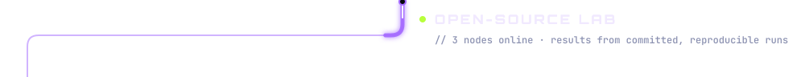
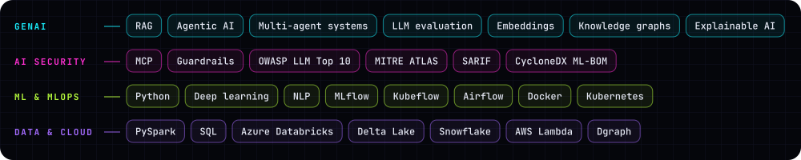

  

  <a href="https://sushmit-gujar.github.io/"><b>Portfolio</b></a> &nbsp;·&nbsp;
  <a href="https://sushmit-gujar.github.io/projects/"><b>Open-source lab</b></a> &nbsp;·&nbsp;
  <a href="https://www.linkedin.com/in/sushmitt/"><b>LinkedIn</b></a>

I'm a Senior AI/ML Engineer with 8+ years of shipping production ML and GenAI in regulated industries: pharma (Johnson & Johnson), telecom (Comcast) and financial crime. My day job covers agentic AI, RAG, knowledge graphs and real-time LLM inference. On my own time I build **open-source AI security and evaluation tools**. Each one runs end to end with no paid API keys and commits its eval results, so you can check every number below yourself.

  
  
  
  
  

| Project | What it is | Headline result | Links |
|---|---|---|---|
| [**aiwatch**](https://github.com/sushmit-gujar/aiwatch) | Find → fix → monitor for AI stacks: ML deps + MCP servers vs live OSV advisories, risky loaders, HF refs, model artifacts; resolver-aware fixes; daily Action with SARIF, tracking issue and dashboard | Demo app: 257 advisories → 0 after `aiwatch fix` (272 findings resolved); 129 newly disclosed advisories flagged vs a baseline; 899/900 agreement with OSV.dev | [repo](https://github.com/sushmit-gujar/aiwatch) · [dashboard](https://sushmit-gujar.github.io/aiwatch/) |
| [**loadsafe**](https://github.com/sushmit-gujar/loadsafe) | ML model supply-chain scanner (pickle/PyTorch/joblib/NumPy, safetensors, ONNX, GGUF, Keras, HF repos) → SARIF + CycloneDX ML-BOM | 100% detection / 0% FPR on its own 26-file PoC corpus (picklescan 33%, modelscan 44%) | [repo](https://github.com/sushmit-gujar/loadsafe) |
| [**mcp-warden**](https://github.com/sushmit-gujar/mcp-warden) | MCP security gateway: policy-as-code, redaction, injection scanning, pinning, exact-call approvals, tamper-evident audit | 30/30 attacks stopped, 12/12 benign allowed; held-out 6/8 (ensemble); +0.78 ms p50 | [repo](https://github.com/sushmit-gujar/mcp-warden) |
| [**hopscope**](https://github.com/sushmit-gujar/hopscope) | GraphRAG vs vector RAG multi-hop benchmark (HotpotQA, 1,000 q) | Full@5 0.699 → 0.746 (+4.7 pts, 95% CI +2.9..+6.5) at 2.4× latency | [repo](https://github.com/sushmit-gujar/hopscope) · [demo](https://sushmit-gujar.github.io/hopscope/) |

### Stack

Every graphic here is a self-hosted SVG with no third-party stat services. Text is outlined from OFL fonts (Orbitron, JetBrains Mono, Space Grotesk) and the animation respects <code>prefers-reduced-motion</code>. To regenerate them, run <code>pip install fonttools && python scripts/build_svgs.py</code>.
